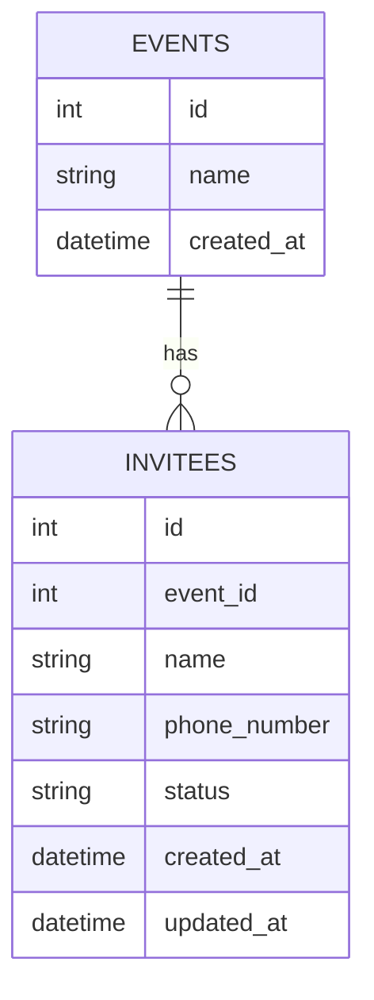
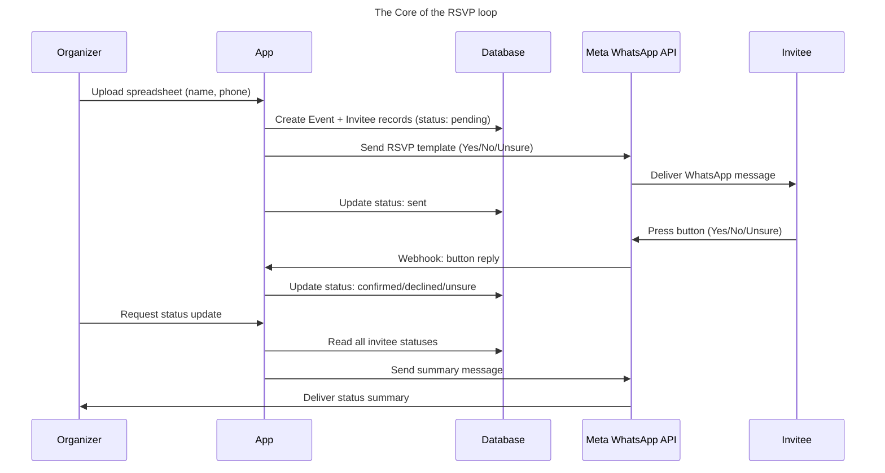

# Data Model

## Events
| Field | Type | Notes |
|---|---|---|
| id | integer, PK | |
| name | string | |
| created_at | datetime | |

## Invitees
| Field | Type | Notes |
|---|---|---|
| id | integer, PK | |
| event_id | integer, FK → Events.id | |
| name | string | |
| phone_number | string | |
| status | enum | pending / sent / confirmed / declined / unsure |
| created_at | datetime | |
| updated_at | datetime | |

Each Invitee belongs to exactly one Event. Multi-event support was 
included from v1 even though the MVP only needs a single event at a 
time, since the underlying business model (per-event pricing, repeat 
organizers) implies this relationship will matter quickly.

NOTE: No Organizers/auth table for MVP — single-operator assumption for v1.

# System Flow

